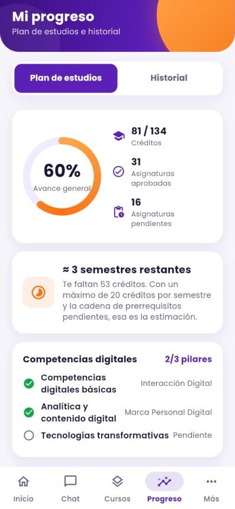
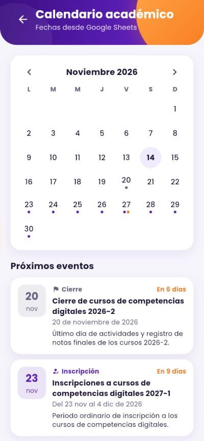
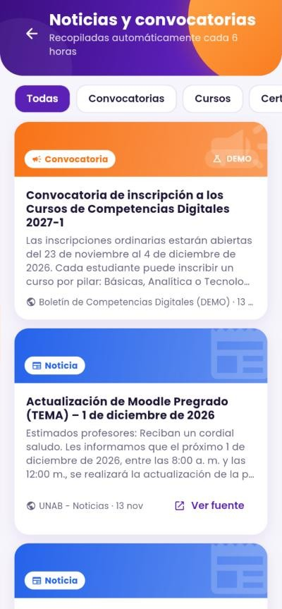
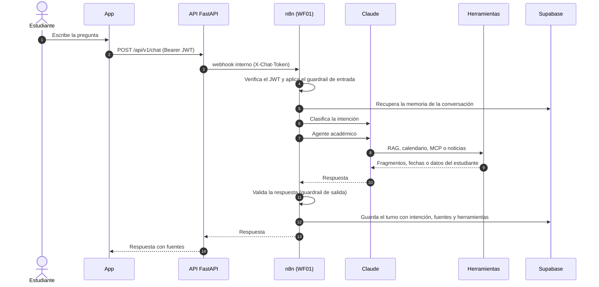

<div align="center">


# Asistente Académico UNAB

Chatbot de apoyo académico con **n8n**, **RAG** y **agentes MCP**.
Responde sobre los Cursos de Competencias Digitales, el calendario, el historial del estudiante y las novedades, siempre con la fuente de cada dato.

Proyecto final de Ciencia de Datos · Ingeniería de Sistemas · Universidad Autónoma de Bucaramanga

[](mobile_app/)
[](backend/)
[](n8n/)
[](mcp-server/)
[](database/)
[](n8n/)
[](docker-compose.yml)
[](docs/manual-instalacion.md#12-despliegue-en-aws-ec2)

[Demo en línea](#demo-en-línea) · [Pantallas](#pantallas) · [Arquitectura](#arquitectura) · [Pruebas](#pruebas) · [Instalación](docs/manual-instalacion.md) · [Decisiones](docs/decisiones.md)

<br>


</div>

> **Datos demostrativos.** El proyecto no tiene acceso a Banner-Cosmos ni a bases de datos institucionales. Los estudiantes, notas, NRC, prerrequisitos, el calendario y los documentos marcados como DEMO son ficticios y no representan información oficial de la UNAB.

## Qué le puedes preguntar

| Tema | Ejemplo | De dónde sale la respuesta |
|---|---|---|
| Insignia y cursos | ¿Cuántos cursos necesito para la insignia de competencias digitales? | Documentos (RAG) |
| Reglamento | ¿Cuántas veces puedo cancelar un mismo curso? | Reglamento estudiantil (RAG, con página) |
| Fechas y plazos | ¿Hasta cuándo tengo plazo para inscribirme? | Calendario en Google Sheets |
| Mi historial | ¿Qué cursos de competencias digitales he aprobado? | Servidor MCP sobre PostgreSQL |
| Recomendaciones | ¿Cuál me recomiendas del pilar de tecnologías y por qué? | Servidor MCP (afinidad con el pensum) |
| Costos y requisitos | ¿Puedo hacer la práctica si debo alguna materia? | Documentos + datos del estudiante |
| Novedades | ¿Qué convocatorias se han publicado? | Scraper programado en n8n |

Si la pregunta necesita varias fuentes ("¿cuándo son las inscripciones y qué curso me recomiendas?"), el agente las combina en una sola respuesta. Si algo no está en las fuentes, lo dice en lugar de inventarlo.

## Demo en línea

La app está publicada en AWS EC2 y responde mientras el laboratorio de AWS Academy está encendido.

| Dónde | Cómo |
|---|---|
| Navegador o iPhone | Abrir **https://chatbot-unab-demo.duckdns.org**. En Safari: Compartir → *Agregar a pantalla de inicio* |
| Android | Instalar el APK generado con `flutter build apk` (ver el [manual](docs/manual-instalacion.md#10-app-móvil)) |

Usuario de prueba: `U00900100` · contraseña `Demo2026*` (estudiante DEMO). En el login, *Usar cuenta de prueba* llena los campos.

## Pantallas

<table>
  <tr>
    <td align="center"><br><sub>Bienvenida</sub></td>
    <td align="center"><br><sub>Inicio de sesión</sub></td>
    <td align="center"><br><sub>Inicio: insignia y avance</sub></td>
    <td align="center"><br><sub>Chat con fuentes</sub></td>
  </tr>
  <tr>
    <td align="center"><br><sub>Cursos por pilar</sub></td>
    <td align="center"><br><sub>Progreso en la carrera</sub></td>
    <td align="center"><br><sub>Recomendaciones</sub></td>
    <td align="center"><br><sub>Calendario</sub></td>
  </tr>
</table>

<details>
<summary>Más pantallas</summary>
<br>
<table>
  <tr>
    <td align="center"><br><sub>Noticias y convocatorias</sub></td>
    <td align="center"><br><sub>Más y acerca del asistente</sub></td>
  </tr>
</table>

El diseño parte de los mockups de [`docs/mockups/`](docs/mockups/) y usa el logo, los colores y la tipografía (Poppins) del manual de marca de la universidad.
</details>

## Arquitectura


La app solo habla con la API. La API valida el token del estudiante y le pasa la pregunta a n8n, donde un agente con Claude decide qué herramientas usar. El código del estudiante siempre sale del token verificado, nunca del mensaje ni del modelo, y PostgreSQL filtra cada consulta con seguridad a nivel de fila.

Detalle completo, contratos entre servicios y diagrama en imagen: [`docs/arquitectura/arquitectura.md`](docs/arquitectura/arquitectura.md).

<details>
<summary>Flujo de una pregunta, paso a paso</summary>
<br>


</details>

<details>
<summary>Componentes y carpetas</summary>
<br>

| Componente | Tecnología | Carpeta | Detalle |
|---|---|---|---|
| App móvil | Flutter + Dart | [`mobile_app/`](mobile_app/) | Android y versión web, consume solo la API |
| API segura | FastAPI | [`backend/`](backend/) | Login con JWT, datos con RLS, límites de uso |
| Orquestación | n8n | [`n8n/`](n8n/) | 4 workflows principales y 2 auxiliares |
| Herramientas MCP | FastMCP | [`mcp-server/`](mcp-server/) | 7 herramientas de solo lectura, HTTP streamable en el puerto 9000 |
| RAG | Voyage AI + pgvector | [`rag/`](rag/) | Ingesta, búsqueda híbrida y evaluación |
| Noticias | Python | [`scraper/`](scraper/) | RSS y HTML respetando `robots.txt` |
| Base de datos | Supabase PostgreSQL | [`database/`](database/) | 10 migraciones, vistas, RLS y datos DEMO |
| Infraestructura | Docker, Caddy, AWS EC2 | [`infrastructure/`](infrastructure/) | HTTPS automático y despliegue reproducible |
</details>

<details>
<summary>Workflows de n8n</summary>
<br>

| Workflow | Qué hace |
|---|---|
| WF01 · Consulta general | Entrada del chat: token → guardrail → memoria → clasificador → agente con herramientas → validación |
| WF02 · Calendario | Lee la hoja de Google Sheets y calcula si cada evento es próximo, está en curso o terminó |
| WF03 · Cursos realizados | Verifica el token y llama la herramienta MCP permitida |
| WF04 · Noticias | Cada 6 horas extrae las fuentes con el scraper y guarda sin duplicados |
| AUX · Búsqueda en documentos | Embedding de la pregunta y búsqueda híbrida en pgvector |
| AUX · Ingesta de documentos | Limpia, fragmenta y vectoriza el corpus; solo reprocesa lo que cambió |

Más detalle en [`n8n/README.md`](n8n/README.md).
</details>

<details>
<summary>Seguridad</summary>
<br>

- **Identidad:** JWT con emisor, audiencia y vencimiento, verificado en la API, en n8n y en el servidor MCP.
- **Datos:** seguridad a nivel de fila en PostgreSQL y un rol de base de datos por servicio con permisos mínimos.
- **Entrada:** bloqueo de inyección de instrucciones, SQL y preguntas sobre otros estudiantes; las cédulas, correos y teléfonos se ocultan antes de llegar al modelo.
- **Salida:** se ocultan tokens y claves, y se reemplaza cualquier fecha, NRC o nota que no venga de una herramienta.
- **Herramientas:** el modelo nunca ve el token del estudiante; solo elige consultas de una lista blanca.
- **Red:** en AWS solo Caddy publica puertos con HTTPS; n8n y el scraper quedan en la red interna.
- **Uso:** límite de intentos de login por IP, bloqueo de cuenta y límite de mensajes por minuto.

Cada bloqueo queda registrado en la tabla `evento_seguridad`.
</details>

## Pruebas

| Suite | Resultado |
|---|---|
| Chat de punta a punta en n8n (`tests/integracion/probar_chat.py`) | 22/22 |
| API de punta a punta, local y contra AWS (`tests/integracion/probar_api.py`) | 12/12 |
| API, pruebas unitarias (`backend/`) | 36 aprobadas |
| App Flutter (`flutter test`) | 9 aprobadas |
| Evaluación del RAG (22 preguntas) | acierto@5 100 % · MRR 0,97 · rechazo fuera de alcance 100 % |

El detalle de cada caso, incluidas las pruebas de seguridad, está en [`docs/pruebas.md`](docs/pruebas.md).

## Inicio rápido

<details>
<summary>Levantar todo en local</summary>
<br>

```powershell
git clone https://github.com/Codemikey21/chatbot.git
cd chatbot
Copy-Item .env.example .env        # completar los valores
docker compose up -d --build
docker compose exec n8n n8n import:workflow --separate --input=/data/workflows
cd mobile_app
flutter run
```

Antes hay que crear la base en Supabase (migraciones y datos DEMO), las credenciales de n8n y publicar los workflows. Todo está paso a paso en el [manual de instalación](docs/manual-instalacion.md).
</details>

<details>
<summary>Estructura del repositorio</summary>
<br>

```text
chatbot/
├── mobile_app/          App Flutter (Android y web)
├── backend/             API FastAPI
├── mcp-server/          Servidor FastMCP
├── scraper/             Scraper de noticias
├── n8n/workflows/       Workflows exportados (se importan con IDs fijos)
├── rag/                 Corpus, ingesta y evaluación del RAG
├── database/            Migraciones SQL y datos DEMO
├── infrastructure/      Caddy y despliegue en AWS
├── tests/integracion/   Pruebas de punta a punta
├── docs/                Arquitectura, manual, pruebas, decisiones y evidencias
├── docker-compose.yml   Servicios en local
└── docker-compose.aws.yml  Caddy y ajustes para EC2
```
</details>

<details>
<summary>Estado del proyecto</summary>
<br>

| Fase | Descripción | Estado |
|---|---|---|
| 1 | Arquitectura y contratos | Completa |
| 2 | Base de datos | Completa |
| 3 | Servidor MCP | Completa |
| 4 | RAG e ingesta | Completa |
| 5 | Workflows de n8n | Completa |
| 6 | Guardrails, intención, memoria y API | Completa |
| 7 | App móvil | Completa (Flutter en lugar de Kotlin, pendiente de confirmar con el profesor) |
| 8 | Despliegue en AWS EC2 | Completa |
| 9 | Pruebas | Completa en local y en AWS |
| 10 | Documentación y video | En curso: falta grabar el video |
</details>

## Documentación

| Documento | Contenido |
|---|---|
| [Arquitectura](docs/arquitectura/arquitectura.md) | Componentes, contratos, ruteo por intención y seguridad por capas |
| [Modelo entidad-relación](docs/arquitectura/modelo-er.md) | Tablas, vistas y relaciones |
| [Manual de instalación](docs/manual-instalacion.md) | Local y AWS EC2, paso a paso |
| [Pruebas](docs/pruebas.md) | Suites, casos y resultados |
| [Decisiones](docs/decisiones.md) | Qué se decidió y por qué |
| [Guion del video](docs/guion-video.md) | Escenas y preguntas de la demostración |

## Autor

**Miguel Ángel Solano Díaz y Andi Lin** · Ingeniería de Sistemas, UNAB · [github.com/Codemikey21](https://github.com/Codemikey21)
