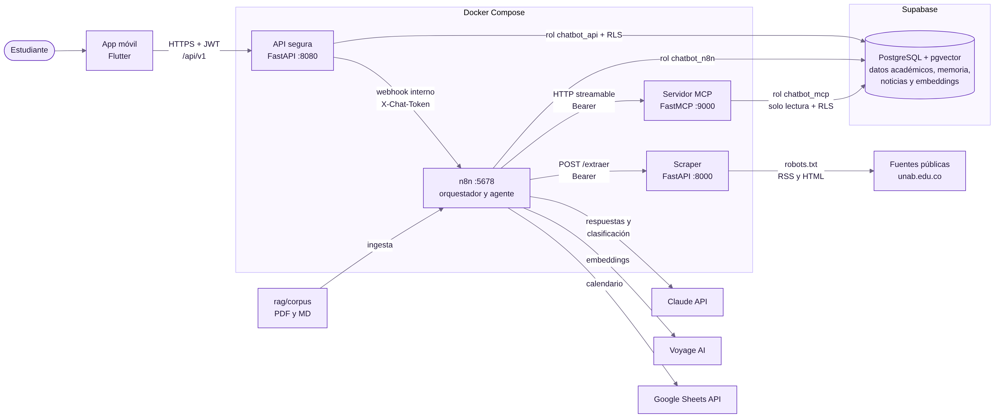

# Asistente académico UNAB — chatbot con n8n, RAG y agentes MCP

Asistente conversacional que permite a los estudiantes de la Universidad Autónoma de Bucaramanga (UNAB) consultar los cursos de competencias digitales, su historial académico, el calendario institucional y las novedades, y recibir recomendaciones personalizadas.

Proyecto final de la asignatura Ciencia de Datos — Ingeniería de Sistemas, UNAB.

> **Datos demostrativos.** Este proyecto no tiene acceso a Banner-Cosmos ni a bases de datos institucionales. Los estudiantes, calificaciones, cursos y documentos marcados como DEMO son ficticios y no representan información oficial de la UNAB.

## Qué puede responder

| Módulo | Ejemplo de pregunta | Fuente |
|---|---|---|
| Ruta académica y cursos | ¿Qué es la insignia de competencias digitales? | Base de datos y documentos |
| RAG institucional | ¿Cuántas veces puedo cancelar un curso según el reglamento? | Documentos con pgvector, con cita de la fuente |
| Calendario académico | ¿Cuándo son las inscripciones? | Google Sheets |
| Historial personalizado | ¿Qué cursos he aprobado y qué me falta para la insignia? | Servidor MCP sobre PostgreSQL |
| Recomendaciones | ¿Qué curso me recomiendas y por qué? | Servidor MCP sobre PostgreSQL |
| Noticias y convocatorias | ¿Qué convocatorias se han publicado? | Scraper programado en n8n |

## Arquitectura



| Componente | Tecnología | Carpeta |
|---|---|---|
| App móvil | Flutter + Dart | `mobile_app/` |
| API segura | FastAPI (Python) | `backend/` |
| Orquestación y agentes | n8n | `n8n/` |
| Modelo de lenguaje | Claude (API de Anthropic) | — |
| Herramientas académicas (MCP) | FastMCP (Python) | `mcp-server/` |
| Noticias y convocatorias | Scraper en Python | `scraper/` |
| RAG | n8n + Voyage AI + pgvector | `rag/` |
| Base de datos | Supabase PostgreSQL + pgvector | `database/` |
| Calendario | Google Sheets API | — |
| Infraestructura | Docker Compose, Caddy y AWS EC2 | `infrastructure/` |

El detalle de cada componente, el flujo de una pregunta, el ruteo por intención y la seguridad por capas están en [`docs/arquitectura/arquitectura.md`](docs/arquitectura/arquitectura.md).

## Estructura del repositorio

```text
chatbot/
├── mobile_app/        # App Flutter
├── backend/           # API FastAPI
├── mcp-server/        # Servidor FastMCP
├── scraper/           # Scraper de noticias
├── n8n/workflows/     # Workflows exportados
├── rag/               # Corpus y evaluación del RAG
├── database/          # Migraciones SQL y datos sintéticos
├── infrastructure/    # Caddy y despliegue en AWS
├── tests/             # Pruebas de integración
├── docs/              # Documentación, mockups y evidencias
└── docker-compose.yml
```

## Inicio rápido

```powershell
Copy-Item .env.example .env          # completar los valores
docker compose up -d --build
docker compose exec n8n n8n import:workflow --separate --input=/data/workflows
cd mobile_app; flutter run
```

Antes hay que crear la base en Supabase, las credenciales de n8n y publicar los workflows. Los pasos completos están en el [manual de instalación](docs/manual-instalacion.md).

Usuario de prueba: `U00900100` / `Demo2026*`.

## Documentación

| Documento | Contenido |
|---|---|
| [`docs/arquitectura/arquitectura.md`](docs/arquitectura/arquitectura.md) | Arquitectura, contratos entre servicios y seguridad |
| [`docs/arquitectura/modelo-er.md`](docs/arquitectura/modelo-er.md) | Modelo entidad-relación |
| [`docs/manual-instalacion.md`](docs/manual-instalacion.md) | Instalación paso a paso y problemas comunes |
| [`docs/pruebas.md`](docs/pruebas.md) | Pruebas y resultados |
| [`docs/decisiones.md`](docs/decisiones.md) | Decisiones técnicas y su motivo |
| [`docs/guion-video.md`](docs/guion-video.md) | Guion y plan del video demostrativo |
| README de cada carpeta | Detalle de cada servicio |

## Estado del proyecto

| Fase | Descripción | Estado |
|---|---|---|
| 0 | Entorno y conectividad | Completa |
| 1 | Arquitectura y contratos | Completa |
| 2 | Base de datos | Completa |
| 3 | Servidor MCP | Completa |
| 4 | RAG e ingesta | Completa |
| 5 | Workflows de n8n | Completa |
| 6 | Guardrails, intención, memoria y API | Completa |
| 7 | App móvil | Completa (Flutter; falta confirmar con el profesor el cambio desde Kotlin) |
| 8 | Despliegue en AWS EC2 | Pendiente |
| 9 | Pruebas | En curso: verificadas en local, falta repetirlas en AWS |
| 10 | Documentación y demo | En curso: falta grabar el video |

## Autor

Miguel Ángel Solano Díaz — Ingeniería de Sistemas, UNAB.
