<div align="center">


# Asistente Académico UNAB

Chatbot de apoyo académico con **n8n**, **RAG** y **agentes MCP**.
Responde sobre los Cursos de Competencias Digitales, el calendario, el historial del estudiante y las novedades, siempre con la fuente de cada dato.

Proyecto final de Ciencia de Datos · Ingeniería de Sistemas · Universidad Autónoma de Bucaramanga

[](mobile_app/)
[](backend/)
[](n8n/)
[](mcp-server/)
[](database/)
[](n8n/)
[](docker-compose.yml)
[](docs/manual-instalacion.md#12-despliegue-en-aws-ec2)

[Demo](#demo-en-línea) · [Pantallas](#pantallas) · [Arquitectura](#arquitectura) · [RAG](#rag) · [Base de datos](#base-de-datos) · [n8n](#workflows-de-n8n) · [MCP y webhook](#servidor-mcp-y-webhook) · [Noticias](#noticias) · [Enfoque pedagógico](#enfoque-pedagógico) · [Pruebas](#pruebas) · [Manual de usuario](docs/manual-usuario.md)

<br>


</div>

> **Datos demostrativos.** El proyecto no tiene acceso a Banner-Cosmos ni a bases de datos institucionales. Los estudiantes, notas, NRC, prerrequisitos, el calendario y los documentos marcados como DEMO son ficticios y no representan información oficial de la UNAB.

## Qué le puedes preguntar

| Tema | Ejemplo | De dónde sale la respuesta |
|---|---|---|
| Insignia y cursos | ¿Cuántos cursos necesito para la insignia de competencias digitales? | Documentos (RAG) |
| Reglamento | ¿Cuántas veces puedo cancelar un mismo curso? | Reglamento estudiantil (RAG, con página) |
| Fechas y plazos | ¿Hasta cuándo tengo plazo para inscribirme? | Calendario en Google Sheets |
| Mi historial | ¿Qué cursos de competencias digitales he aprobado? | Servidor MCP sobre PostgreSQL |
| Matrícula y proyección | ¿Qué materias puedo matricular y cuántos semestres me faltan? | Servidor MCP + calendario |
| Recomendaciones | ¿Cuál me recomiendas del pilar de tecnologías y por qué? | Servidor MCP (afinidad con el pensum) |
| Costos y requisitos | ¿Puedo hacer la práctica si debo alguna materia? | Documentos + datos del estudiante |
| Plan de estudios | ¿Cuál es el prerrequisito de Desarrollo de Aplicaciones Móviles? | Plan de estudios (RAG) |
| Novedades | ¿Qué convocatorias se han publicado? | Scraper programado en n8n |

Si la pregunta necesita varias fuentes ("¿cuándo son las inscripciones y qué curso me recomiendas?"), el agente las combina en una sola respuesta. Si algo no está en las fuentes, lo dice en lugar de inventarlo.

## Demo en línea

La app está publicada en AWS EC2 y responde mientras el laboratorio de AWS Academy está encendido.

| Dónde | Cómo |
|---|---|
| Navegador o iPhone | Abrir **https://chatbot-unab-demo.duckdns.org**. En Safari: Compartir → *Agregar a pantalla de inicio* |
| Android | Instalar el APK generado con `flutter build apk` (ver el [manual](docs/manual-instalacion.md#10-app-móvil)) |

Usuario de prueba: `U00900100` · contraseña `Demo2026*` (estudiante DEMO). En el login, *Usar cuenta de prueba* llena los campos.

## Pantallas

<table>
  <tr>
    <td align="center">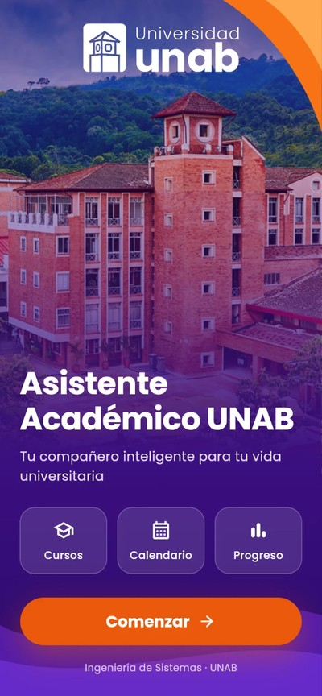<br><sub>Bienvenida</sub></td>
    <td align="center"><br><sub>Inicio de sesión</sub></td>
    <td align="center"><br><sub>Inicio: insignia y avance</sub></td>
    <td align="center">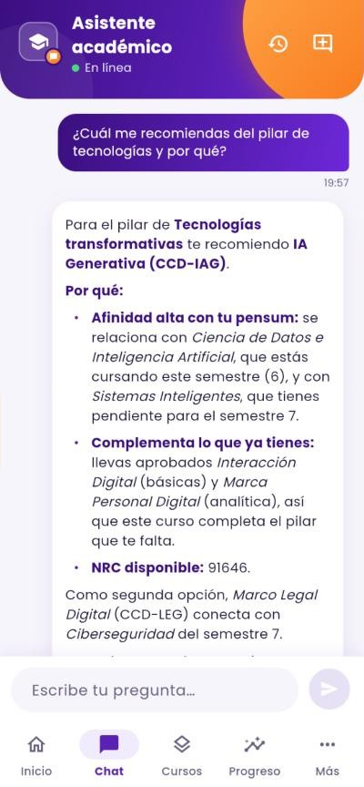<br><sub>Chat con fuentes</sub></td>
  </tr>
  <tr>
    <td align="center"><br><sub>Cursos por pilar</sub></td>
    <td align="center"><br><sub>Progreso en la carrera</sub></td>
    <td align="center">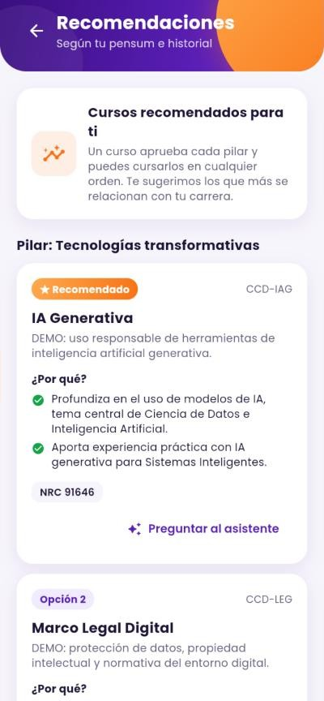<br><sub>Recomendaciones</sub></td>
    <td align="center"><br><sub>Calendario</sub></td>
  </tr>
</table>

<details>
<summary>Más pantallas</summary>
<br>
<table>
  <tr>
    <td align="center"><br><sub>Noticias y convocatorias</sub></td>
    <td align="center">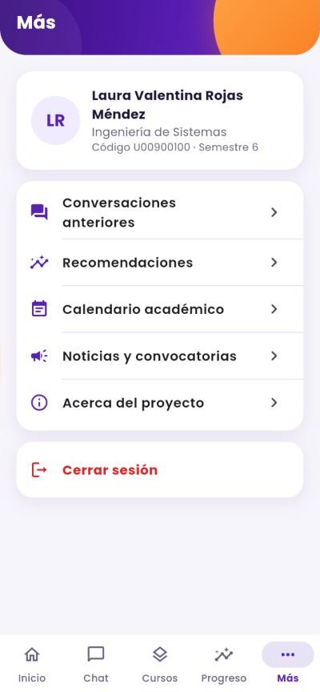<br><sub>Más y acerca del asistente</sub></td>
  </tr>
</table>

El diseño parte de los mockups de [`docs/mockups/`](docs/mockups/) y usa el logo, los colores y la tipografía (Poppins) del manual de marca de la universidad.
</details>

## Arquitectura

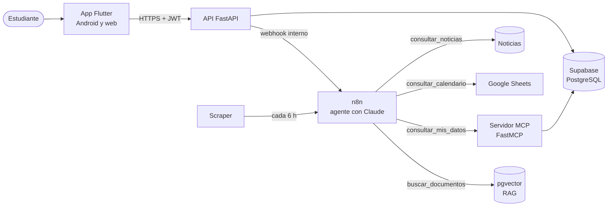

La app solo habla con la API. La API valida el token del estudiante y le pasa la pregunta a n8n, donde un agente con Claude decide qué herramientas usar. El código del estudiante siempre sale del token verificado, nunca del mensaje ni del modelo, y PostgreSQL filtra cada consulta con seguridad a nivel de fila.

Detalle completo, contratos entre servicios y diagrama en imagen: [`docs/arquitectura/arquitectura.md`](docs/arquitectura/arquitectura.md).

**Por qué está armado así**

- **Una API delante de n8n.** El webhook de n8n nunca queda expuesto: la API valida el login, limita el uso y firma el token que n8n vuelve a verificar. Así n8n se dedica a orquestar.
- **Un agente con herramientas en lugar de un flujo por intención.** Muchas preguntas mezclan temas («¿cuándo me inscribo y qué curso me sirve?»). El agente combina RAG, calendario, MCP y noticias en una sola respuesta; el clasificador de intención sigue filtrando lo que está fuera de alcance antes de llamar al modelo.
- **Datos personales solo por MCP.** El servidor MCP es de solo lectura, recibe el token del estudiante y PostgreSQL aplica seguridad a nivel de fila. El modelo nunca escribe SQL ni ve el token.
- **RAG híbrido con umbral.** La búsqueda vectorial entiende paráfrasis y la de texto completo encuentra códigos y números de artículo. Si nada supera la similitud mínima, el chatbot dice que no encontró la información.
- **Todo en Docker.** Cada servicio arranca y se revisa por separado (`/health`), en local y en EC2 con el mismo `docker-compose.yml`.

Todas las decisiones, con fecha y motivo: [`docs/decisiones.md`](docs/decisiones.md).

<details>
<summary>Flujo de una pregunta, paso a paso</summary>
<br>

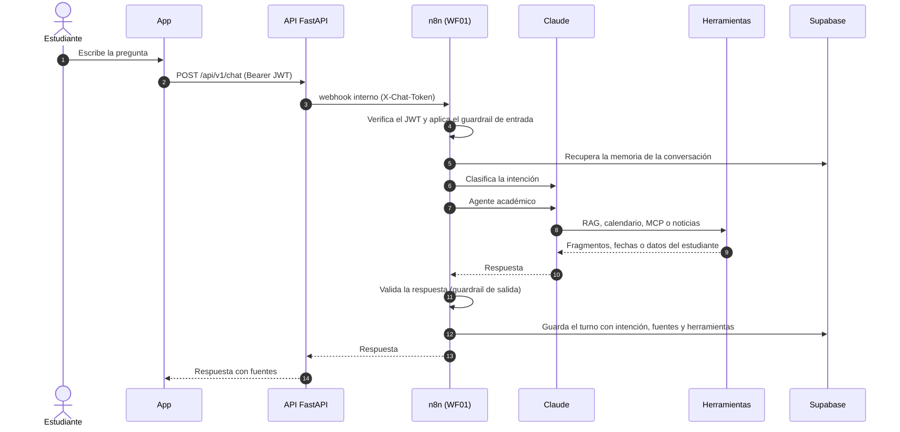
</details>

<details>
<summary>Componentes y carpetas</summary>
<br>

| Componente | Tecnología | Carpeta | Detalle |
|---|---|---|---|
| App móvil | Flutter + Dart | [`mobile_app/`](mobile_app/) | Android y versión web, consume solo la API |
| API segura | FastAPI | [`backend/`](backend/) | Login con JWT, datos con RLS, límites de uso |
| Orquestación | n8n | [`n8n/`](n8n/) | 4 workflows principales y 2 auxiliares |
| Herramientas MCP | FastMCP | [`mcp-server/`](mcp-server/) | 7 herramientas de solo lectura, HTTP streamable en el puerto 9000 |
| RAG | Voyage AI + pgvector | [`rag/`](rag/) | Ingesta, búsqueda híbrida y evaluación |
| Noticias | Python | [`scraper/`](scraper/) | RSS y HTML respetando `robots.txt` |
| Base de datos | Supabase PostgreSQL | [`database/`](database/) | 10 migraciones, vistas, RLS y datos DEMO |
| Infraestructura | Docker, Caddy, AWS EC2 | [`infrastructure/`](infrastructure/) | HTTPS automático y despliegue reproducible |
</details>


<details>
<summary>Seguridad</summary>
<br>

- **Identidad:** JWT con emisor, audiencia y vencimiento, verificado en la API, en n8n y en el servidor MCP.
- **Datos:** seguridad a nivel de fila en PostgreSQL y un rol de base de datos por servicio con permisos mínimos.
- **Entrada:** bloqueo de inyección de instrucciones, SQL y preguntas sobre otros estudiantes; las cédulas, correos y teléfonos se ocultan antes de llegar al modelo.
- **Salida:** se ocultan tokens y claves, y se reemplaza cualquier fecha, NRC o nota que no venga de una herramienta.
- **Herramientas:** el modelo nunca ve el token del estudiante; solo elige consultas de una lista blanca.
- **Red:** en AWS solo Caddy publica puertos con HTTPS; n8n y el scraper quedan en la red interna.
- **Uso:** límite de intentos de login por IP, bloqueo de cuenta y límite de mensajes por minuto.

Cada bloqueo queda registrado en la tabla `evento_seguridad`.
</details>

## RAG

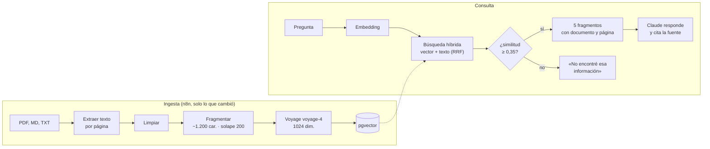

| Tipo | Documentos |
|---|---|
| Reglamento | Reglamento estudiantil de pregrado (público, UNAB) |
| Plan de estudios | Plan de estudios de Ingeniería de Sistemas por semestre, con prerrequisitos (DEMO) y lineamientos curriculares (público, UNAB) |
| Requisitos | Reglamento de la insignia, catálogo de cursos, prueba diagnóstica y preguntas frecuentes de los CCD (DEMO) |

Fragmentos de ~1.200 caracteres con 200 de solape, cortados por párrafo o artículo para que cada uno trate una sola idea; embeddings de Voyage `voyage-4` (1024 dimensiones, distingue documento y consulta); umbral de similitud 0,35 elegido con la evaluación. La justificación de cada parámetro está en [`rag/README.md`](rag/README.md#parámetros-y-por-qué).

Recuperación real del conjunto de evaluación:

| Pregunta | Similitud | Primer documento recuperado |
|---|---:|---|
| ¿Cuántos cursos necesito aprobar para obtener la insignia? | 0,754 | Reglamento de la insignia |
| ¿Cuántas veces puedo cancelar un mismo curso? | 0,655 | Reglamento estudiantil |
| ¿Cómo se organiza el plan de estudios según los lineamientos curriculares? | 0,681 | Lineamientos curriculares |
| ¿Qué asignaturas se ven en sexto semestre de Ingeniería de Sistemas? | 0,652 | Plan de estudios |
| ¿Cuál es la receta del ajiaco santafereño? | — | Ninguno: se rechaza |

**Resultado con 25 preguntas:** acierto@5 100 %, MRR 0,95 y 100 % de rechazo de preguntas fuera de alcance ([detalle](docs/pruebas.md#3-evaluación-del-rag)).

## Base de datos

<p align="center">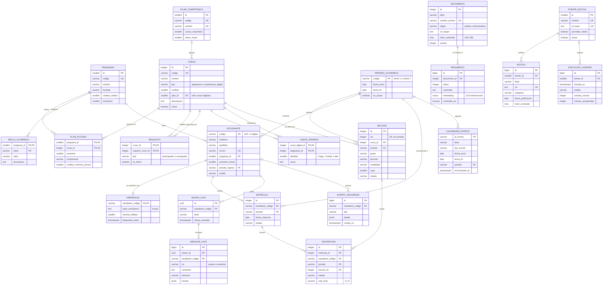</p>

Supabase PostgreSQL con pgvector. El modelo cubre estudiantes, programa, plan de estudios, asignaturas, prerrequisitos, periodos, secciones (NRC), matrículas, inscripciones con nota, reglas académicas, calendario, documentos y fragmentos con embeddings, noticias, sesiones y mensajes del chat.

| Script | Contenido |
|---|---|
| [`001_extensiones_y_catalogo.sql`](database/migrations/001_extensiones_y_catalogo.sql) | pgvector, programa, pilares, cursos, plan de estudios, requisitos, reglas, periodos y secciones |
| [`002_estudiantes_e_historial.sql`](database/migrations/002_estudiantes_e_historial.sql) | Estudiantes, credenciales, matrículas e inscripciones con nota |
| [`003_calendario_rag_noticias.sql`](database/migrations/003_calendario_rag_noticias.sql) | Calendario, documentos, fragmentos (`vector(1024)`, índice HNSW) y noticias |
| [`004_chat_y_seguridad.sql`](database/migrations/004_chat_y_seguridad.sql) | Sesiones y mensajes del chat, eventos de seguridad |
| [`005_vistas.sql`](database/migrations/005_vistas.sql) | Historial, avance del plan, insignia, asignaturas habilitadas, **proyección de semestres** y recomendaciones |
| [`006_roles_seguridad_y_rls.sql`](database/migrations/006_roles_seguridad_y_rls.sql) | Un rol por servicio y políticas RLS por estudiante |
| [`007`](database/migrations/007_funciones_rag.sql) a [`010`](database/migrations/010_requisito_practica.sql) | Funciones del RAG, del chat y de noticias; requisito de la práctica |
| [`seeds/`](database/seeds/) | Catálogo, 12 estudiantes DEMO con historial, calendario y fuentes de noticias |

<table>
  <tr>
    <td align="center">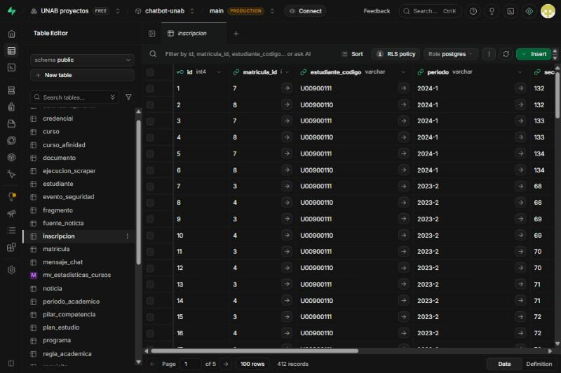<br><sub>Tabla <code>inscripcion</code> en Supabase (412 registros)</sub></td>
    <td align="center">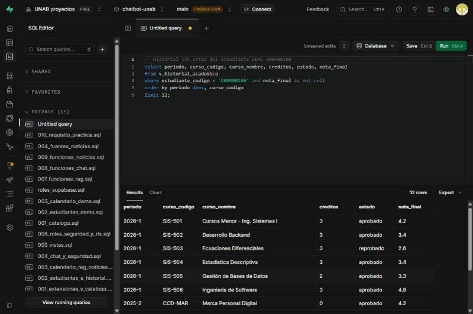<br><sub>Historial con notas de un estudiante</sub></td>
    <td align="center">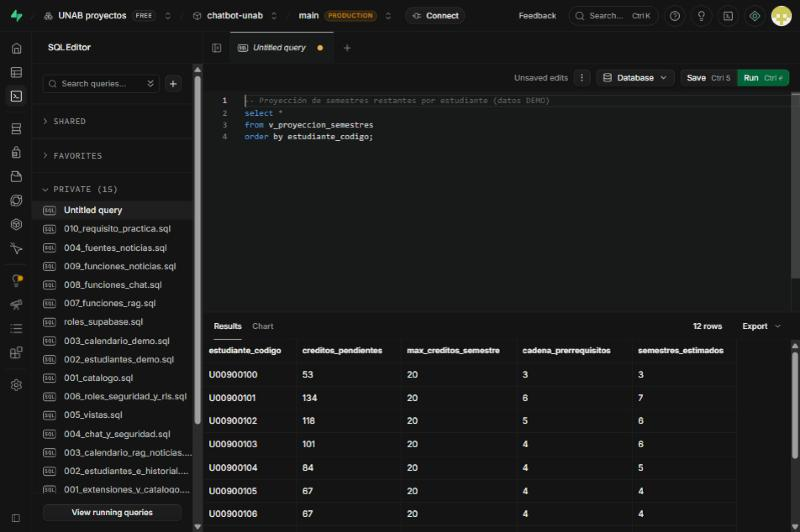<br><sub>Proyección de semestres restantes</sub></td>
  </tr>
</table>

## Workflows de n8n

<p align="center">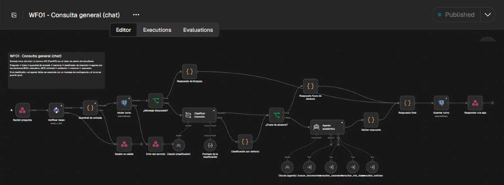</p>

WF01 recibe la pregunta, verifica el token, aplica el guardrail de entrada, recupera la memoria, clasifica la intención y pasa al agente con Claude y sus cuatro herramientas. La respuesta pasa por el guardrail de salida y se guarda el turno.

| Workflow | Qué hace |
|---|---|
| WF01 · Consulta general | Entrada del chat: token → guardrail → memoria → clasificador → agente con herramientas → validación |
| WF02 · Calendario | Lee la hoja de Google Sheets y calcula si cada evento es próximo, está en curso o terminó |
| WF03 · Cursos realizados | Verifica el token y llama la herramienta MCP permitida |
| WF04 · Noticias | Cada 6 horas extrae las fuentes con el scraper y guarda sin duplicados |
| AUX · Búsqueda en documentos | Embedding de la pregunta y búsqueda híbrida en pgvector |
| AUX · Ingesta de documentos | Limpia, fragmenta y vectoriza el corpus; solo reprocesa lo que cambió |

<table>
  <tr>
    <td align="center" width="50%">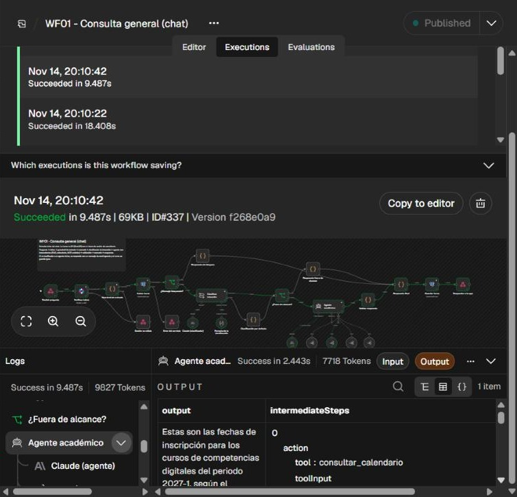<br><sub>Ejecución exitosa de WF01: el agente usa <code>consultar_calendario</code></sub></td>
    <td align="center" width="50%">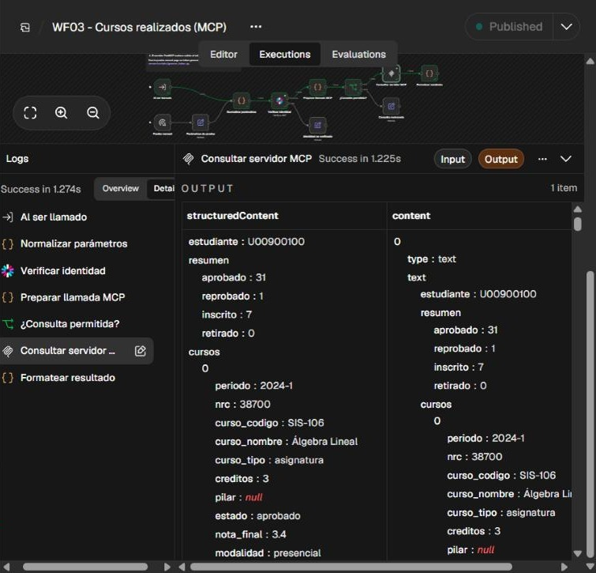<br><sub>WF03 llamando al servidor MCP: historial del estudiante desde PostgreSQL</sub></td>
  </tr>
</table>

Los JSON importables están en [`n8n/workflows/`](n8n/workflows/) y la guía de importación en [`n8n/README.md`](n8n/README.md).

## Servidor MCP y webhook

Servidor FastMCP en Python, HTTP streamable en el puerto 9000 (`/mcp`), con token Bearer. Todas las herramientas son de solo lectura y consultan PostgreSQL con consultas parametrizadas.

| Herramienta | Qué devuelve |
|---|---|
| `consultar_cursos_disponibles` | Cursos de competencias digitales abiertos (NRC, cupos, modalidad), pilares y regla de la insignia |
| `obtener_requisitos` | Prerrequisitos y correquisitos de un curso; con token, si el estudiante ya puede matricularlo |
| `consultar_calendario` | Eventos del calendario académico |
| `consultar_noticias` | Noticias y convocatorias del scraper |
| `consultar_historial` | Historial del estudiante: periodo, NRC, curso, estado y nota |
| `consultar_progreso` | Insignia, avance del plan, semestres restantes y materias que puede matricular |
| `obtener_recomendaciones` | Curso recomendado por pilar pendiente, con la razón |

Cómo conectarlo desde n8n, MCP Inspector, Claude u OpenAI: [`mcp-server/README.md`](mcp-server/README.md#conectar-clientes-mcp).

**Prueba del webhook.** La app y Swagger llaman a `POST /api/v1/chat`, que reenvía la pregunta al webhook de WF01. Ejemplo real con el estudiante DEMO:

<p align="center">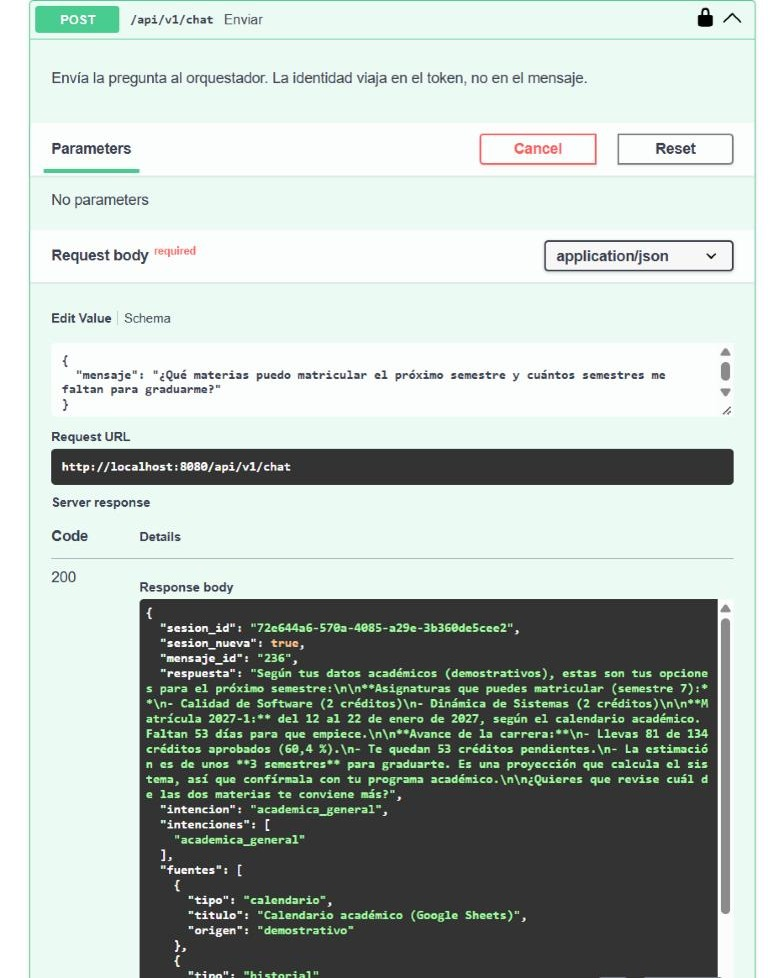</p>

```text
Pregunta:  ¿Qué materias puedo matricular el próximo semestre y cuántos semestres me faltan para graduarme?
Herramientas: consultar_mis_datos (MCP), consultar_calendario (Google Sheets)

Asignaturas que puedes matricular (semestre 7): Calidad de Software (2 créditos), Dinámica de Sistemas (2 créditos)
Matrícula 2027-1: del 12 al 22 de enero de 2027. Faltan 53 días.
Llevas 81 de 134 créditos (60,4 %); te quedan 53. Estimación: unos 3 semestres.
```

Además, [`tests/integracion/probar_chat.py`](tests/integracion/probar_chat.py) envía 23 casos directo al webhook (RAG, calendario, MCP, noticias, memoria, guardrails y tokens falsos o vencidos): **23/23**.

## Noticias


WF04 se ejecuta cada 6 horas. Por cada fuente activa llama al scraper, que revisa `robots.txt`, descarga el RSS o el HTML, limpia el texto y clasifica la entrada (convocatoria, certificación, curso o noticia). n8n guarda solo lo nuevo, con su fuente y fecha, y el agente lo consulta con `consultar_noticias`.

| Fuente | Tipo | Filtro |
|---|---|---|
| UNAB · Noticias | RSS público | Palabras de educación, tecnología e ingeniería (estudiante, curso, convocatoria, tecnología, ingeniería, sistemas, inteligencia artificial…) |
| Boletín de Competencias Digitales | HTML (DEMO) | Demuestra la extracción con selectores CSS |

Detalle del scraper: [`scraper/README.md`](scraper/README.md).

<br clear="right">

## Enfoque pedagógico

| Enfoque | Cómo se nota en el asistente |
|---|---|
| Educación de precisión | Cada respuesta personal sale de los datos del estudiante: materias habilitadas, proyección con prerrequisitos, cursos recomendados por afinidad con su pensum |
| Autoaprendizaje | El estudiante planea (qué matricular, cuándo), monitorea (progreso e historial) y reflexiona (el porqué de cada recomendación y la fuente de cada dato) cuando quiera |
| Investigación | Respuestas con fuente y sin inventar; ruta Estadística → Ingeniería Basada en Evidencia → Soluciones Innovadoras en el plan; convocatorias del scraper |

El prompt completo del agente, la relación de cada regla con estos enfoques y las referencias (Hart, 2016; Zimmerman, 2002; Yang, 2021, entre otras) están en [`docs/fundamento-pedagogico.md`](docs/fundamento-pedagogico.md).


## Pruebas

| Suite | Resultado |
|---|---|
| Chat de punta a punta en n8n (`tests/integracion/probar_chat.py`) | 23/23 |
| API de punta a punta, local y contra AWS (`tests/integracion/probar_api.py`) | 12/12 |
| API, pruebas unitarias (`backend/`) | 36 aprobadas |
| App Flutter (`flutter test`) | 9 aprobadas |
| Servidor MCP (`pytest`) | 25 aprobadas |
| Scraper (`pytest`) | 25 aprobadas |
| Evaluación del RAG (25 preguntas) | acierto@5 100 % · MRR 0,95 · rechazo fuera de alcance 100 % |

El detalle de cada caso, incluidas las pruebas de seguridad, está en [`docs/pruebas.md`](docs/pruebas.md).

## Inicio rápido

<details>
<summary>Levantar todo en local</summary>
<br>

```powershell
git clone https://github.com/Codemikey21/chatbot.git
cd chatbot
Copy-Item .env.example .env        # completar los valores
docker compose up -d --build
docker compose exec n8n n8n import:workflow --separate --input=/data/workflows
cd mobile_app
flutter run
```

Antes hay que crear la base en Supabase (migraciones y datos DEMO), las credenciales de n8n y publicar los workflows. Todo está paso a paso en el [manual de instalación](docs/manual-instalacion.md).
</details>

<details>
<summary>Estructura del repositorio</summary>
<br>

```text
chatbot/
├── mobile_app/          App Flutter (Android y web)
├── backend/             API FastAPI
├── mcp-server/          Servidor FastMCP
├── scraper/             Scraper de noticias
├── n8n/workflows/       Workflows exportados (se importan con IDs fijos)
├── rag/                 Corpus, ingesta y evaluación del RAG
├── database/            Migraciones SQL y datos DEMO
├── infrastructure/      Caddy y despliegue en AWS
├── tests/integracion/   Pruebas de punta a punta
├── docs/                Arquitectura, manuales, pruebas, decisiones y evidencias
├── docker-compose.yml   Servicios en local
└── docker-compose.aws.yml  Caddy y ajustes para EC2
```
</details>

<details>
<summary>Estado del proyecto</summary>
<br>

| Fase | Descripción | Estado |
|---|---|---|
| 1 | Arquitectura y contratos | Completa |
| 2 | Base de datos | Completa |
| 3 | Servidor MCP | Completa |
| 4 | RAG e ingesta | Completa |
| 5 | Workflows de n8n | Completa |
| 6 | Guardrails, intención, memoria y API | Completa |
| 7 | App móvil | Completa (Flutter en lugar de Kotlin, aprobado por el profesor) |
| 8 | Despliegue en AWS EC2 | Completa |
| 9 | Pruebas | Completa en local y en AWS |
| 10 | Documentación y video | Completa |
</details>

## Documentación

| Documento | Contenido |
|---|---|
| [Arquitectura](docs/arquitectura/arquitectura.md) | Componentes, contratos, ruteo por intención y seguridad por capas |
| [Modelo entidad-relación](docs/arquitectura/modelo-er.md) | Tablas, vistas y relaciones |
| [Manual de usuario](docs/manual-usuario.md) | Cómo usar la app y el chat, con ejemplos y solución de problemas |
| [Manual de instalación](docs/manual-instalacion.md) | Local y AWS EC2, paso a paso |
| [Pruebas](docs/pruebas.md) | Suites, casos y resultados |
| [Decisiones](docs/decisiones.md) | Qué se decidió y por qué |
| [Fundamento pedagógico](docs/fundamento-pedagogico.md) | Educación de precisión, autoaprendizaje, investigación, prompts y referencias |
| [RAG](rag/README.md) | Ingesta, parámetros, búsqueda y evaluación |
| [Guion del video](docs/guion-video.md) | Escenas y preguntas de la demostración |

## Autor

**Miguel Ángel Solano Díaz y Andi Lin** · Ingeniería de Sistemas, UNAB · [github.com/Codemikey21](https://github.com/Codemikey21)
