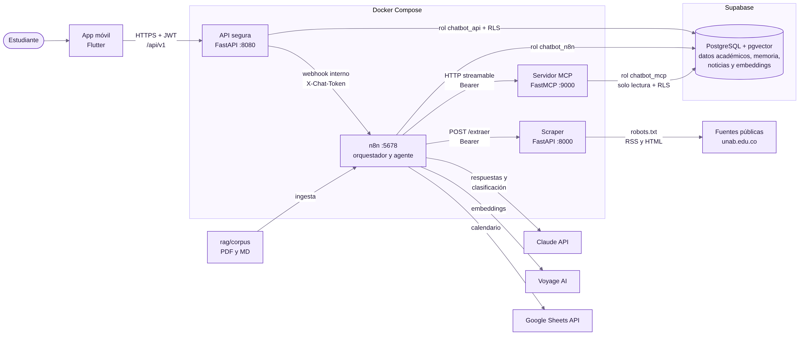
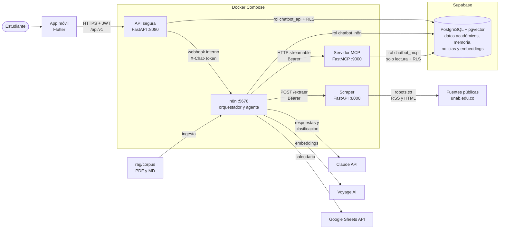
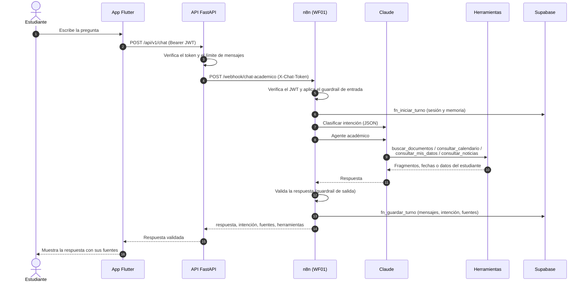

# Arquitectura del sistema

El asistente es un sistema híbrido: una app móvil habla solo con una API segura; la API reenvía las preguntas a n8n, donde un agente con Claude decide qué fuentes consultar (documentos con RAG, la base académica por MCP, el calendario en Google Sheets o las noticias del scraper) y devuelve una respuesta con sus fuentes. Todos los datos viven en Supabase PostgreSQL con pgvector.

Cada componente corre en su propio contenedor, tiene un endpoint de salud y se puede probar por separado.

## Diagrama general

## Componentes

| Componente | Tecnología | Puerto y exposición | Responsabilidad | Cómo diagnosticarlo |
|---|---|---|---|---|
| App móvil | Flutter + Dart | — | Login, inicio, chat con fuentes, cursos, progreso, recomendaciones, calendario y noticias | `flutter run`, mensajes de error en pantalla |
| API segura | FastAPI | 8080 (local: solo `127.0.0.1`) | Login con JWT, datos del estudiante con RLS, puente hacia n8n, límites de uso | `GET /health`, `docker compose logs api` |
| Orquestador | n8n 2.46.7 | 5678 (solo `127.0.0.1`, nunca público) | Guardrails, memoria, clasificación de intención, agente con herramientas, ingesta y noticias programadas | `/healthz`, pestaña *Executions* |
| Servidor MCP | FastMCP (Python) | 9000, ruta `/mcp` | 7 herramientas de solo lectura sobre la base académica | `GET /health`, MCP Inspector |
| Scraper | FastAPI (Python) | 8000, solo red interna de Docker | Extrae noticias de RSS y HTML respetando `robots.txt` | `GET /health`, tabla `ejecucion_scraper` |
| Base de datos | Supabase PostgreSQL + pgvector | Externo (session pooler 5432, SSL) | Datos académicos DEMO, memoria del chat, noticias, documentos y embeddings | Supabase > SQL Editor, tabla `evento_seguridad` |
| Modelo de lenguaje | Claude (`claude-haiku-5-5`) | Externo | Clasificar la intención y generar la respuesta | Ejecución del nodo en n8n |
| Embeddings | Voyage AI (`voyage-4`, 1024) | Externo | Vectores de los fragmentos y de las preguntas | Ejecución de AUX en n8n |
| Calendario | Google Sheets API | Externo | Fechas del calendario académico DEMO | Ejecución de WF02 |

## Flujo de una pregunta

## Ruteo por intención

El clasificador de WF01 (Claude con salida JSON) asigna una o varias intenciones. Si la pregunta está fuera del ámbito académico, se responde sin llamar al agente. Si no, el agente recibe la intención como guía y puede combinar varias herramientas en la misma respuesta.

| Intención | Ejemplo | Herramienta principal | Workflow |
|---|---|---|---|
| `academica_general` | ¿Qué puedes hacer? | El agente responde y consulta si hace falta | WF01 |
| `documental` | ¿Cuántas veces puedo cancelar un curso? | `buscar_documentos` (RAG) | AUX búsqueda |
| `calendario` | ¿Cuándo son las inscripciones? | `consultar_calendario` (Google Sheets) | WF02 |
| `historial` | ¿Qué cursos de competencias digitales he realizado? | `consultar_mis_datos` (MCP) | WF03 |
| `recomendacion` | ¿Qué curso me recomiendas? | `consultar_mis_datos` (MCP) | WF03 |
| `noticias` | ¿Qué convocatorias hay? | `consultar_noticias` | WF04 |
| `fuera_de_alcance` | Receta del ajiaco | Ninguna: respuesta de alcance | WF01 |

## Contratos entre servicios

| Origen → destino | Protocolo | Autenticación | Contrato |
|---|---|---|---|
| App → API | HTTP JSON, `/api/v1` | `Authorization: Bearer <JWT>` | `backend/README.md` y `/docs` (OpenAPI) |
| API → n8n | HTTP JSON, `POST /webhook/chat-academico` | `X-Chat-Token` | Entrada y salida en `n8n/README.md` |
| n8n → servidor MCP | MCP sobre HTTP streamable, `/mcp` | Bearer `MCP_AUTH_TOKEN` + JWT del estudiante como parámetro | `mcp-server/README.md` |
| n8n → scraper | HTTP JSON, `POST /extraer` | Bearer `SCRAPER_TOKEN` | `scraper/README.md` |
| API, n8n y MCP → Supabase | PostgreSQL con SSL | Un rol por servicio | `docs/arquitectura/modelo-er.md` |
| n8n → Claude, Voyage y Sheets | HTTPS | Credenciales guardadas en n8n | `n8n/README.md` |

## Seguridad por capas

| Capa | Medida |
|---|---|
| Red | En EC2 solo Caddy publica puertos (80, 443 y 9000, con HTTPS). La API y el MCP quedan detrás de Caddy; n8n y el scraper no tienen puertos abiertos a internet y n8n se administra por túnel SSH. SSH solo acepta la IP del desarrollador. |
| Identidad | JWT HS256 con emisor, audiencia y vencimiento, verificado en la API, en WF01, en WF03 y en el servidor MCP. El código del estudiante sale del token, nunca del mensaje ni del modelo. |
| Datos | RLS en PostgreSQL con `app.estudiante_id` fijado en cada transacción. Pedir datos de otro estudiante devuelve vacío o 404. |
| Mínimo privilegio | Roles separados `chatbot_api`, `chatbot_n8n` y `chatbot_mcp`. El MCP es de solo lectura y el scraper no tiene acceso a la base. |
| Entrada | El guardrail bloquea inyección de instrucciones, SQL y preguntas sobre otros códigos; oculta cédulas, correos, teléfonos y tarjetas. |
| Salida | Oculta tokens, claves y correos; reemplaza respuestas con fechas, NRC o notas que no vengan de una herramienta (reducción de alucinaciones). El RAG responde que no encontró la información si ningún fragmento supera el umbral. |
| Herramientas | Lista blanca de consultas en WF03. El modelo nunca recibe el token del estudiante. |
| Uso | 10 intentos de login cada 5 minutos por IP, bloqueo de 15 minutos tras 5 fallos y 12 mensajes de chat por minuto por estudiante. |
| Secretos | Todo en `.env` y en credenciales de n8n; nada escrito en el código ni en los workflows exportados. |
| Auditoría | Bloqueos y alertas en `evento_seguridad`; cada ejecución del scraper en `ejecucion_scraper`. |

## Despliegue

**Local (verificado):** los cuatro servicios corren con `docker compose up -d` en el equipo de desarrollo, con los puertos publicados solo en `127.0.0.1`. La app se conecta desde el emulador por `10.0.2.2:8080` o desde un celular Android por USB con `adb reverse`. Los pasos están en `docs/manual-instalacion.md`.

**AWS EC2 (verificado el 2026-11-14):** instancia `t3.medium` con Ubuntu 24.04 en el Learner Lab (us-west-2, la misma región de Supabase), con IP elástica, el dominio `chatbot-unab-demo.duckdns.org` y Caddy como proxy con HTTPS automático (Let's Encrypt). Se levanta con `docker-compose.yml` más `docker-compose.aws.yml`.

| Puerto | Uso |
|---|---|
| 22 | SSH, solo desde la IP del desarrollador (también sirve de túnel para entrar a n8n) |
| 80 y 443 | Caddy: certificado HTTPS, la API en `/api/v1` y la versión web de la app en `/` |
| 9000 | Servidor MCP con HTTP streamable detrás de Caddy con HTTPS, como pide la actividad |

La versión web y la API comparten el dominio, así que no hace falta CORS en producción. La documentación interactiva de la API (`/docs`) está apagada en AWS. Los contenedores usan `restart: unless-stopped`, así que vuelven a arrancar solos cuando el laboratorio se reinicia. Los pasos están en `docs/manual-instalacion.md` (sección 12).

## Documentos relacionados

- `docs/arquitectura/modelo-er.md`: modelo entidad-relación y tablas.
- `docs/decisiones.md`: decisiones técnicas con su motivo.
- `docs/manual-instalacion.md`: instalación paso a paso.
- `docs/pruebas.md`: pruebas y resultados.
- READMEs de cada carpeta: `backend/`, `n8n/`, `mcp-server/`, `rag/`, `scraper/` y `mobile_app/`.
