# Modelo entidad-relación

Base de datos PostgreSQL (Supabase) con la extensión pgvector. El esquema se crea con los scripts de `database/migrations/` y se llena con `database/seeds/`.

Convenciones:
- Nombres en español, en minúscula y con guion bajo.
- **PK**: llave primaria · **FK**: llave foránea · **UK**: valor único.
- Los datos marcados como DEMO son sintéticos y no corresponden a registros oficiales de la UNAB.

## Diagrama

```mermaid
erDiagram
    PROGRAMA ||--o{ PLAN_ESTUDIO : "define"
    CURSO ||--o{ PLAN_ESTUDIO : "aparece en"
    PILAR_COMPETENCIA |o--o{ CURSO : "agrupa"
    CURSO ||--o{ REQUISITO : "exige"
    CURSO ||--o{ REQUISITO : "es requerido por"
    CURSO ||--o{ CURSO_AFINIDAD : "curso digital"
    CURSO ||--o{ CURSO_AFINIDAD : "asignatura"
    PROGRAMA ||--o{ REGLA_ACADEMICA : "configura"
    CURSO ||--o{ SECCION : "se ofrece en"
    PERIODO_ACADEMICO ||--o{ SECCION : "contiene"
    PROGRAMA ||--o{ ESTUDIANTE : "tiene"
    PERIODO_ACADEMICO ||--o{ ESTUDIANTE : "ingreso"
    ESTUDIANTE ||--|| CREDENCIAL : "se autentica con"
    ESTUDIANTE ||--o{ MATRICULA : "realiza"
    PERIODO_ACADEMICO ||--o{ MATRICULA : "corresponde a"
    MATRICULA ||--o{ INSCRIPCION : "incluye"
    SECCION ||--o{ INSCRIPCION : "recibe"
    PERIODO_ACADEMICO |o--o{ CALENDARIO_EVENTO : "agenda"
    DOCUMENTO ||--o{ FRAGMENTO : "se divide en"
    FUENTE_NOTICIA ||--o{ NOTICIA : "publica"
    FUENTE_NOTICIA |o--o{ EJECUCION_SCRAPER : "registra"
    ESTUDIANTE ||--o{ SESION_CHAT : "abre"
    SESION_CHAT ||--o{ MENSAJE_CHAT : "contiene"
    ESTUDIANTE |o--o{ EVENTO_SEGURIDAD : "genera"

    PROGRAMA {
        smallint id PK
        varchar codigo UK
        varchar nombre
        varchar facultad
        smallint creditos_totales
        smallint semestres
    }
    PILAR_COMPETENCIA {
        smallint id PK
        varchar codigo UK
        varchar nombre UK
        smallint cursos_requeridos
        smallint orden_visual
    }
    CURSO {
        integer id PK
        varchar codigo UK
        varchar nombre
        varchar tipo "asignatura o competencia_digital"
        smallint creditos
        smallint pilar_id FK "solo cursos digitales"
        text descripcion
        boolean activo
    }
    PLAN_ESTUDIO {
        smallint programa_id PK, FK
        integer curso_id PK, FK
        smallint semestre
        varchar componente
        smallint creditos_minimos_previos
    }
    REQUISITO {
        integer curso_id PK, FK
        integer requiere_curso_id PK, FK
        varchar tipo "prerrequisito o correquisito"
        boolean es_demo
    }
    REGLA_ACADEMICA {
        smallint programa_id PK, FK
        varchar clave PK
        numeric valor
        text descripcion
    }
    CURSO_AFINIDAD {
        integer curso_digital_id PK, FK
        integer asignatura_id PK, FK
        smallint afinidad "1 baja, 2 media, 3 alta"
        text razon
    }
    PERIODO_ACADEMICO {
        varchar codigo PK "AAAA-1 o AAAA-2"
        date fecha_inicio
        date fecha_fin
        boolean es_actual
    }
    SECCION {
        integer id PK
        integer nrc "UK con periodo"
        integer curso_id FK
        varchar periodo FK
        varchar grupo
        varchar docente
        varchar modalidad
        smallint cupo
        varchar estado
    }
    ESTUDIANTE {
        varchar codigo PK "U00 + 6 digitos"
        varchar nombres
        varchar apellidos
        varchar correo UK
        smallint programa_id FK
        smallint semestre_actual
        varchar periodo_ingreso FK
        varchar estado
    }
    CREDENCIAL {
        varchar estudiante_codigo PK, FK
        text hash_contrasena "bcrypt"
        smallint intentos_fallidos
        timestamptz bloqueado_hasta
    }
    MATRICULA {
        integer id PK
        varchar estudiante_codigo FK
        varchar periodo FK
        date fecha_matricula
        varchar estado
    }
    INSCRIPCION {
        integer id PK
        integer matricula_id FK
        varchar estudiante_codigo FK
        varchar periodo FK
        integer seccion_id FK
        varchar estado
        numeric nota_final "0 a 5"
    }
    CALENDARIO_EVENTO {
        varchar id_evento PK
        varchar titulo
        varchar tipo_evento
        date fecha_inicio
        date fecha_fin
        varchar periodo FK
        timestamptz sincronizado_en
    }
    DOCUMENTO {
        integer id PK
        varchar titulo
        varchar nombre_archivo UK
        varchar origen "publico o demostrativo"
        text url_origen
        char hash_contenido "SHA-256"
        integer version
    }
    FRAGMENTO {
        bigint id PK
        integer documento_id FK
        integer indice
        text contenido
        vector embedding "1024 dimensiones"
        tsvector contenido_tsv
    }
    FUENTE_NOTICIA {
        smallint id PK
        varchar nombre UK
        text url_base UK
        boolean permitido_robots
        boolean activa
    }
    NOTICIA {
        bigint id PK
        smallint fuente_id FK
        varchar titulo
        text url UK
        varchar categoria
        date fecha_publicacion
        char hash_contenido
    }
    EJECUCION_SCRAPER {
        bigint id PK
        smallint fuente_id FK
        timestamptz iniciado_en
        varchar estado
        integer noticias_nuevas
        integer noticias_actualizadas
    }
    SESION_CHAT {
        uuid id PK
        varchar estudiante_codigo FK
        varchar titulo
        timestamptz ultima_actividad
    }
    MENSAJE_CHAT {
        bigint id PK
        uuid sesion_id FK
        varchar estudiante_codigo FK
        varchar rol "usuario o asistente"
        text contenido
        varchar intencion
        jsonb fuentes
    }
    EVENTO_SEGURIDAD {
        bigint id PK
        varchar estudiante_codigo FK
        varchar tipo
        jsonb detalle
        timestamptz creado_en
    }
```

## Grupos de tablas

| Grupo | Tablas | Contenido |
|---|---|---|
| Catálogo académico | `programa`, `curso`, `pilar_competencia`, `plan_estudio`, `requisito`, `regla_academica`, `curso_afinidad`, `periodo_academico`, `seccion` | Pensum, cursos de competencias digitales, prerrequisitos, reglas y oferta por periodo (NRC) |
| Estudiantes | `estudiante`, `credencial`, `matricula`, `inscripcion` | Datos personales e historial académico, protegidos con RLS |
| Contenido | `calendario_evento`, `documento`, `fragmento`, `fuente_noticia`, `noticia`, `ejecucion_scraper` | Calendario sincronizado con Google Sheets, documentos del RAG con embeddings y noticias recopiladas |
| Conversación | `sesion_chat`, `mensaje_chat`, `evento_seguridad` | Memoria persistente del chat y bitácora de guardrails |

## Reglas de integridad destacadas

- **Tipo de curso garantizado por la base de datos.** `curso` tiene una llave única `(id, tipo)`. `plan_estudio` solo acepta asignaturas y `curso_afinidad` solo acepta un curso digital y una asignatura, mediante llaves foráneas compuestas.
- **Pilar coherente.** Un curso tiene pilar si y solo si es de competencias digitales.
- **NRC por periodo.** El NRC es único dentro de cada periodo, como en Banner.
- **Inscripción en el periodo correcto.** `inscripcion` referencia `(matricula_id, estudiante_codigo, periodo)` y `(seccion_id, periodo)`, así que no se puede inscribir un NRC de otro periodo ni a nombre de otro estudiante.
- **Mensajes en la sesión correcta.** `mensaje_chat` referencia `(sesion_id, estudiante_codigo)`.
- **Notas coherentes.** Los estados aprobado y reprobado exigen nota; inscrito y retirado no la tienen.

## Vistas

| Vista | Uso |
|---|---|
| `v_historial_academico` | Historial con el detalle de cada curso |
| `v_progreso_competencias` | Avance por pilar de competencias digitales |
| `v_estado_insignia` | Pilares aprobados, pendientes e insignia obtenida |
| `v_avance_plan` | Créditos aprobados y porcentaje del pensum |
| `v_asignaturas_pendientes` | Materias pendientes, prerrequisitos faltantes y si ya se pueden matricular |
| `v_proyeccion_semestres` | Semestres restantes estimados |
| `v_recomendacion_cursos` | Cursos digitales recomendados con sus razones |
| `v_oferta_disponible` | NRC abiertos con cupos disponibles |
| `v_proximos_eventos` | Calendario desde hoy |
| `v_noticias_recientes` | Noticias con su fuente |
| `mv_estadisticas_cursos` | Vista materializada con inscritos, aprobación y nota promedio por curso |

## Seguridad

- Tres roles con permisos mínimos: `chatbot_api` (FastAPI), `chatbot_mcp` (servidor MCP, solo lectura) y `chatbot_n8n` (ingesta, noticias, calendario y memoria).
- Row Level Security activo en todas las tablas. Los datos personales solo son visibles para el estudiante fijado en `app.estudiante_id`, que se toma del JWT verificado.
- Las vistas con datos personales usan `security_invoker`, así que respetan el RLS de quien consulta.
- Las contraseñas solo se leen dentro de `fn_autenticar`, que bloquea la cuenta 15 minutos tras 5 intentos fallidos.
