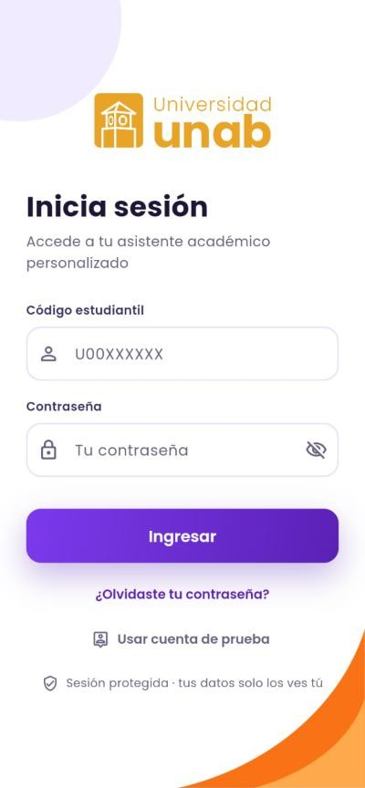
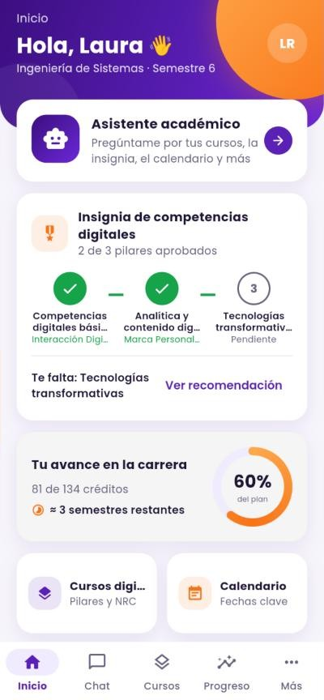
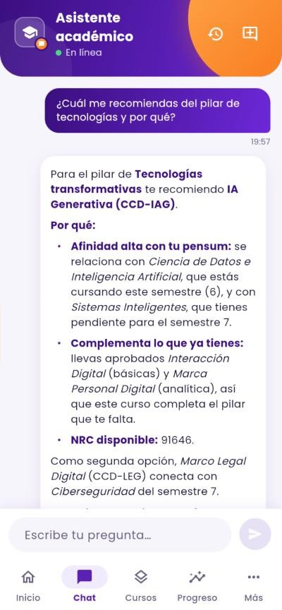
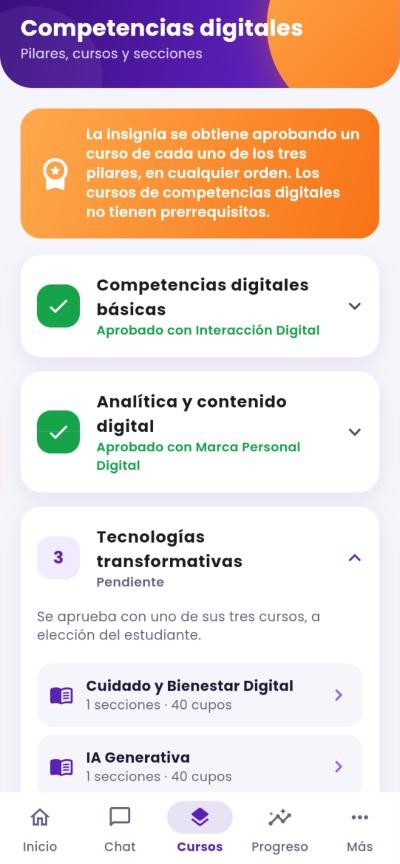
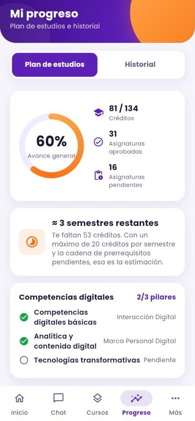
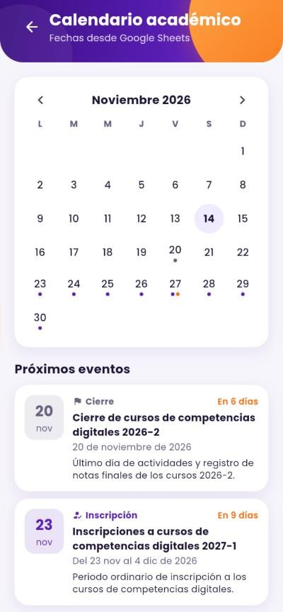

# Manual de usuario

Guía para el estudiante que usa el Asistente Académico UNAB desde el celular o el navegador.

> Todos los estudiantes, notas, NRC, fechas y documentos marcados como DEMO son datos de prueba. No representan información oficial de la UNAB.

## 1. Qué puedes hacer con el asistente

- Preguntar por los Cursos de Competencias Digitales: qué son, cuánto cuestan, cuáles te faltan para la insignia y cuál te conviene.
- Revisar tu avance en la carrera: créditos aprobados, materias pendientes, qué puedes matricular y cuántos semestres te faltan.
- Consultar fechas del calendario académico: inscripciones, pruebas diagnósticas, inicio y cierre de cursos.
- Leer noticias y convocatorias recopiladas automáticamente.
- Resolver dudas del reglamento estudiantil, con la referencia al documento.

## 2. Instalación

| Dispositivo | Cómo |
|---|---|
| Android | Instala el archivo `app-release.apk` que te comparten. Si el celular lo pide, permite instalar apps de origen desconocido para el navegador o el administrador de archivos que usaste. |
| iPhone | Abre `https://chatbot-unab-demo.duckdns.org` en Safari → botón **Compartir** → **Agregar a pantalla de inicio**. |
| Computador | Abre `https://chatbot-unab-demo.duckdns.org` en cualquier navegador. |

La versión en línea funciona mientras el servidor de AWS del proyecto está encendido. Si no carga, revisa la sección 9.

## 3. Iniciar sesión

1. En la pantalla de bienvenida pulsa **Comenzar**.
2. Escribe tu **código estudiantil** (por ejemplo `U00900100`) y tu **contraseña**.
3. Pulsa **Ingresar**.

Para la demostración puedes pulsar **Usar cuenta de prueba**, que llena los datos del estudiante DEMO.

- Si escribes mal la contraseña varias veces, la cuenta se bloquea temporalmente por seguridad.
- La sesión vence sola después de un tiempo; si eso pasa, la app te devuelve al inicio de sesión.
- Tus datos solo los ves tú: el asistente nunca muestra información de otros estudiantes.

 

## 4. Pantalla de inicio

Al entrar ves un resumen de tu situación:

- **Insignia de competencias digitales:** los tres pilares, cuáles ya aprobaste y con qué curso. Si te falta uno, el enlace **Ver recomendación** te lleva al curso sugerido.
- **Tu avance en la carrera:** créditos aprobados frente al total del plan y los semestres restantes estimados.
- **Accesos rápidos** a cursos y calendario.
- La tarjeta **Asistente académico** abre el chat.

Abajo está el menú principal: **Inicio, Chat, Cursos, Progreso y Más**.

 

## 5. Chat con el asistente

1. Entra a **Chat**.
2. Escribe tu pregunta en el cuadro *Escribe tu pregunta…* y pulsa el botón de enviar.
3. Mientras el asistente busca la información aparece un indicador de escritura. La respuesta tarda unos segundos, porque el asistente consulta documentos, el calendario o tus datos antes de contestar.

Botones de la parte superior:
- **Reloj (Conversaciones anteriores):** abre una conversación pasada y sigue donde la dejaste. Para archivar una, deslízala hacia la izquierda y confirma.
- **Burbuja con + (Nueva conversación):** empieza una conversación desde cero.

El asistente recuerda lo que hablaron en la misma conversación, así que puedes hacer preguntas de seguimiento como *«¿y si repruebo uno de esos?»* o responder *«sí, me gustaría»* cuando te ofrezca algo.

 

### Preguntas que puedes hacer

| Tema | Ejemplos |
|---|---|
| Insignia y cursos digitales | ¿Qué es la insignia de competencias digitales? · ¿Cuántos cursos necesito? · ¿Cuánto cuesta cada curso? |
| Mi historial | ¿Qué cursos de competencias digitales he realizado? · ¿Cuántos cursos tengo aprobados? |
| Matrícula | ¿Qué materias puedo matricular el próximo semestre? · ¿Cuál es el prerrequisito de Desarrollo de Aplicaciones Móviles? |
| Proyección | ¿Cuántos semestres me faltan para graduarme? · ¿Puedo hacer la práctica si debo alguna materia? |
| Recomendaciones | ¿Qué curso me recomiendas del pilar de tecnologías y por qué? |
| Calendario | ¿Cuándo son las inscripciones? · ¿Hasta cuándo tengo plazo? · ¿Qué actividades vienen? |
| Reglamento | ¿Cuántas veces puedo cancelar un mismo curso? · ¿Qué necesito para obtener el grado? |
| Novedades | ¿Qué convocatorias se han publicado? |

### Cómo leer una respuesta

- Cuando la información sale de un documento, el asistente lo nombra (por ejemplo, *«según el Reglamento estudiantil»*).
- Las fechas salen del calendario académico y los datos personales de tu historial; si son demostrativos, la respuesta lo aclara.
- Si la información no está en las fuentes, el asistente responde que no la encontró y te sugiere a quién acudir. No inventa fechas, notas ni requisitos.
- Las proyecciones de semestres son estimaciones: confírmalas con tu programa académico.

### Lo que el asistente no responde

- Preguntas que no son académicas (recetas, deportes, precios del dólar…).
- Datos de otros estudiantes.
- Instrucciones para que cambie su comportamiento o muestre su configuración.

En esos casos responde con un mensaje corto explicando que no puede ayudar con eso.

## 6. Cursos de competencias digitales

En **Cursos** ves los tres pilares de la insignia:

- Los pilares aprobados aparecen en verde con el curso con el que los aprobaste.
- Los pendientes muestran sus cursos disponibles, con secciones y cupos. Al tocar un curso se abre el detalle de sus secciones: NRC, modalidad y horario.

Recuerda: la insignia se obtiene aprobando un curso de cada pilar, en cualquier orden.

 

## 7. Progreso y recomendaciones

**Progreso** tiene dos pestañas:

- **Plan de estudios:** porcentaje de avance, créditos aprobados, asignaturas aprobadas y pendientes, semestres restantes estimados y estado de la insignia.
- **Historial:** cada curso que has tomado, con periodo, estado y nota.

**Recomendaciones** (desde Inicio o desde Más) sugiere un curso por cada pilar pendiente y explica por qué: su relación con las materias de tu carrera y con lo que ya aprobaste. Desde ahí puedes pulsar **Preguntar al asistente** para profundizar.

 

## 8. Calendario, noticias y opciones

- **Calendario académico** (desde Inicio o Más): mes con los días que tienen eventos marcados y la lista de próximos eventos con cuántos días faltan.
- **Noticias y convocatorias** (desde Más): novedades recopiladas cada 6 horas, filtrables por tipo. Cada una tiene su fecha, la fuente y el botón **Ver fuente** para leerla completa en el sitio original.
- **Más:** tu perfil, conversaciones anteriores, recomendaciones, calendario, noticias, información del proyecto y **Cerrar sesión**.

 

## 9. Problemas comunes

| Qué ves | Qué hacer |
|---|---|
| «No hay conexión» o la pantalla no carga | Revisa tu internet y pulsa **Reintentar**. Si sigue igual, el servidor puede estar apagado: avisa al administrador del proyecto. |
| «El servicio no está disponible en este momento» | El orquestador del chat no respondió. Espera un momento y vuelve a enviar la pregunta. |
| «El servidor tardó demasiado en responder» | La consulta tomó más de lo normal. Intenta de nuevo. |
| «Tu sesión venció. Inicia sesión de nuevo.» | Vuelve a ingresar con tu código y contraseña. |
| «Estás haciendo muchas solicitudes» | Enviaste muchos mensajes seguidos. Espera un minuto. |
| «No encontré esa información» | La respuesta no está en los documentos ni en los datos disponibles. Reformula la pregunta o consulta a tu programa académico. |

## 10. Privacidad

- La app solo muestra tus propios datos, identificados por la sesión con la que ingresaste.
- Si escribes tu cédula, correo o teléfono en el chat, se ocultan antes de enviarse al modelo de lenguaje.
- Las conversaciones se guardan para que el asistente recuerde el contexto; puedes archivarlas deslizándolas en la lista de conversaciones anteriores.
