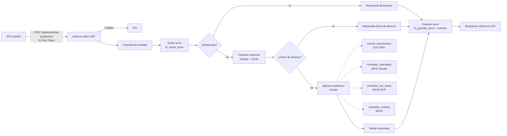

# Workflows de n8n

n8n orquesta el chat, el RAG, el calendario, los datos del estudiante (vía MCP) y las noticias. Los workflows están en `n8n/workflows/` y se importan con IDs fijos, para que las herramientas del agente encuentren sus sub-workflows sin configurar nada a mano.

| Archivo | Workflow | Qué hace |
|---|---|---|
| `WF01-consulta-general.json` | WF01 - Consulta general (chat) | Entrada única del chat: token → guardrail → memoria → clasificador → agente con herramientas → validación → memoria → respuesta |
| `WF02-calendario.json` | WF02 - Consulta de calendario | Lee la hoja `calendario` de Google Sheets, filtra por tipo de evento y calcula si cada evento es próximo, está en curso o terminó |
| `WF03-cursos-realizados.json` | WF03 - Cursos realizados (MCP) | Verifica el token del estudiante y llama la herramienta permitida del servidor FastMCP |
| `WF04-noticias.json` | WF04 - Noticias y nuevos cursos | Cada 6 horas llama al scraper por cada fuente activa y guarda las noticias sin duplicados; además devuelve las novedades al agente |
| `AUX-busqueda-documentos.json` | AUX - Búsqueda en documentos (RAG) | Embedding de la pregunta con Voyage + `fn_buscar_fragmentos` (búsqueda híbrida con umbral) |
| `AUX-ingesta-documentos.json` | AUX - Ingesta de documentos | Carga el corpus en pgvector (ver `rag/README.md`) |

## Flujo del chat (WF01)



**Entrada** (la envía la API):

```json
{ "token_sesion": "<JWT del estudiante>", "sesion_id": "<uuid o null>", "mensaje": "¿Qué curso me recomiendas?" }
```

**Salida**:

```json
{
  "sesion_id": "…", "sesion_nueva": false, "mensaje_id": "…",
  "respuesta": "…", "intencion": "recomendacion", "intenciones": ["recomendacion"],
  "fuentes": [{ "tipo": "documento", "titulo": "…", "pagina": 12, "url": "…", "origen": "publico" }],
  "herramientas": ["consultar_mis_datos"], "bloqueado": false
}
```

## Noticias programadas (WF04)

```text
Cada 6 horas ─► Leer fuentes activas ─► Extraer con el scraper (una llamada por fuente)
             ─► Limpiar y deduplicar ─► Guardar noticias (fn_guardar_noticias) ─► Resumen
```

- Las fuentes están en la tabla `fuente_noticia` (`database/seeds/004_fuentes_noticias.sql`): el feed RSS público de la UNAB y un boletín **DEMO** que sirve el propio scraper.
- El scraper revisa `robots.txt` y una lista blanca de dominios antes de descargar (ver `scraper/README.md`).
- `fn_guardar_noticias` inserta las noticias nuevas, actualiza solo las que cambiaron (hash distinto), actualiza `permitido_robots` de la fuente y registra cada ejecución en `ejecucion_scraper`.
- Para correrlo a mano: en el editor, botón **Execute** → disparador **Cada 6 horas**.

## Seguridad

- **Acceso al webhook:** solo con el encabezado `X-Chat-Token` (secreto compartido con la API). En EC2, n8n no se publica a internet.
- **Identidad:** el token JWT se verifica en WF01 (firma, vencimiento, emisor, audiencia y código), otra vez en WF03 y otra vez en el servidor MCP. El código del estudiante sale del token, nunca del mensaje.
- **El modelo nunca ve el token:** la herramienta `consultar_mis_datos` recibe el token como entrada fija del sub-workflow; el modelo solo elige la consulta (`historial`, `progreso`, `recomendaciones`, `requisitos`, `cursos_disponibles`).
- **Permisos de herramientas:** WF03 tiene una lista blanca de consultas → herramientas MCP; el servidor MCP es de solo lectura y aplica RLS.
- **Guardrail de entrada:** bloquea inyección de instrucciones, consultas sobre otros estudiantes (otro código U00…) y SQL; oculta correos, cédulas, teléfonos y tarjetas antes de enviar el texto al modelo y a la base de datos.
- **Clasificador:** marca las preguntas fuera del ámbito académico.
- **Validación de salida:** oculta tokens, claves, cadenas de conexión, correos de estudiantes y códigos ajenos; si el agente da fechas, NRC o notas sin haber consultado ninguna herramienta, la respuesta se reemplaza por una segura (reducción de alucinaciones).
- **Bitácora:** cada bloqueo o alerta queda en `evento_seguridad`.
- **Memoria:** `fn_iniciar_turno` y `fn_guardar_turno` fijan el estudiante y dejan que RLS controle las sesiones. Los mensajes bloqueados no vuelven a entrar al contexto del modelo.

## Credenciales

Créalas en n8n **antes de importar**, con estos nombres exactos (la importación las enlaza por nombre):

| Nombre | Tipo en n8n | Valor |
|---|---|---|
| `Supabase - n8n` | Postgres | Session pooler, usuario `DB_N8N_USER`, SSL `require`, Ignore SSL Issues |
| `Voyage - embeddings` | Header Auth | `Authorization` = `Bearer <VOYAGE_API_KEY>` |
| `Claude - Anthropic` | Anthropic | `ANTHROPIC_API_KEY` |
| `Google Sheets - calendario` | Google Service Account API | Correo y llave privada de la cuenta de servicio |
| `JWT - sesiones` | JWT Auth | Passphrase = `JWT_SECRET`, algoritmo HS256 |
| `MCP - token servicio` | Bearer Auth | `MCP_AUTH_TOKEN` |
| `Chat - token` | Header Auth | Nombre `X-Chat-Token`, valor = `N8N_WEBHOOK_SECRET` |
| `Scraper - token` | Bearer Auth | `SCRAPER_TOKEN` |
| `Ingesta - token` | Header Auth | Token del webhook de ingesta |

## Importar y publicar

```bash
# 1. Importar (o actualizar) todos los workflows con sus IDs fijos
docker compose exec n8n n8n import:workflow --separate --input=/data/workflows

# 2. En el editor de n8n, abrir cada workflow y pulsar "Publish".
#    Los sub-workflows también deben estar publicados: si no, el agente
#    recibe "Workflow is not active and cannot be executed".
```

## Probar

```bash
# Desde la raíz del repositorio (usa .env para firmar un token de prueba)
mcp-server/.venv/Scripts/python.exe tests/integracion/probar_chat.py
mcp-server/.venv/Scripts/python.exe tests/integracion/probar_chat.py --solo "¿Qué curso me recomiendas?"
```

Cada sub-workflow también tiene un disparador **Prueba manual** con datos de ejemplo para ejecutarlo por separado desde el editor.

## Problemas comunes

| Síntoma | Causa | Solución |
|---|---|---|
| `Workflow is not active and cannot be executed` en una herramienta | El sub-workflow no está publicado | Publicarlo |
| HTTP 403 `Authorization data is wrong!` | Falta o es incorrecto `X-Chat-Token` | Revisar la credencial `Chat - token` y `N8N_WEBHOOK_SECRET` |
| HTTP 401 `Sesión no válida` | Token vencido, mal firmado o con otro emisor/audiencia | Revisar `JWT_SECRET`, `JWT_ISSUER` y `JWT_AUDIENCE` |
| La respuesta dice "no pude consultar mis fuentes" | Falló el modelo (clave, cuota o red) | Revisar la credencial `Claude - Anthropic` y la ejecución en n8n |
| Un nodo muestra la credencial en rojo | El nombre de la credencial no coincide | Seleccionar la credencial en el nodo o renombrarla y volver a importar |
